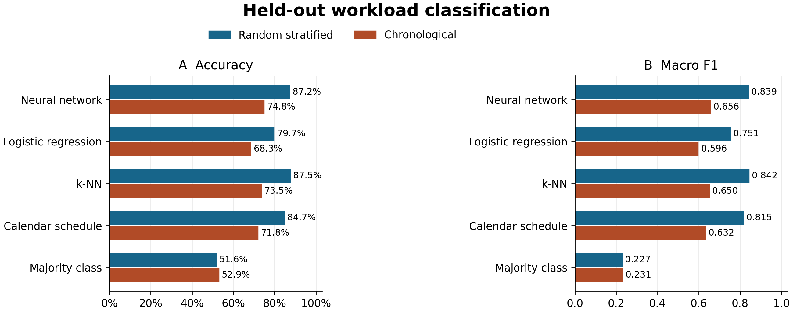
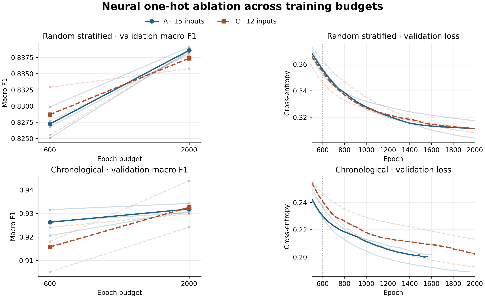

# Steel Industry Workload Classification

A Bilkent University EEE-485 project that classifies **35,040 fifteen-minute steel plant intervals** into Light, Medium, and Maximum load. The study implements logistic regression and a small neural network in NumPy and exact k-nearest neighbors in C++17. Its main result is the difference between random stratified and chronological evaluation on the same 2018 dataset.

[Final results](#random-vs-chronological-test-results) · [Encoding ablation](#full-vs-reduced-one-hot-validation-ablation) · [Method](#method) · [Quickstart](#quickstart) · [Credits and permissions](#credits-and-permissions)

## Random vs chronological test results

| Model | Random accuracy | Random macro F1 | Chronological accuracy | Chronological macro F1 |
| --- | ---: | ---: | ---: | ---: |
| Neural network | 87.17% | 0.8386 | **74.80%** | **0.6561** |
| Logistic regression | 79.68% | 0.7513 | 68.32% | 0.5960 |
| k-NN | **87.47%** | **0.8415** | 73.53% | 0.6496 |
| Calendar schedule baseline | 84.66% | 0.8150 | 71.80% | 0.6315 |
| Majority baseline | 51.58% | 0.2269 | 52.85% | 0.2305 |



Each test partition contains 7,008 intervals and was scored once after the configurations were frozen. The neural network's accuracy fell **12.37 percentage points** from random to chronological testing. Its chronological macro F1 also fell from 0.9298 on validation to 0.6561 on test. The calendar baseline showed a similar validation-to-test decline, from 0.9356 to 0.6315. The split comparison is descriptive and also reflects different training partitions and split-specific settings. [Benchmark protocol, per-class recall, confusion matrices, and runtime](docs/final-benchmark.md) · [Saved test results](docs/final-benchmark.json) · [Vector figure](docs/figures/test-split-comparison.svg)

## Full vs reduced one-hot validation ablation

This neural-network ablation used the same four electrical features and two cyclic time features. **A** adds seven day and two WeekStatus indicators for 15 inputs. **C** drops both WeekStatus indicators and uses Monday as a reference day for 12 inputs. With a bias included, C removes the exact categorical dependencies. Scores are means across initialization seeds 42, 7, and 101 on fixed validation partitions.

| Validation split | Epoch cap | A accuracy | A macro F1 | C accuracy | C macro F1 |
| --- | ---: | ---: | ---: | ---: | ---: |
| Random stratified | 600 | 86.19% | 0.8272 | 86.36% | 0.8287 |
| Random stratified | 2,000 | 87.16% | 0.8386 | 87.12% | 0.8374 |
| Chronological | 600 | 93.33% | 0.9262 | 92.63% | 0.9158 |
| Chronological | 2,000 | 94.07% | 0.9318 | 94.12% | 0.9326 |



Faint lines show individual seeds. Left panels show seed means, and right panels show median loss through the last epoch shared by all seeds in an arm. Each panel has its own y-axis range.

The chronological macro-F1 gap at 600 epochs closed with longer training. Chronological A stopped on patience for all three seeds, with best epochs 1,534–1,924. Both random arms and chronological C reached epoch 2,000 with new validation loss minima. Chronological A had lower mean minimum loss (0.19679 versus 0.20258), while C was frozen for its higher mean chronological validation macro F1. **The small accuracy and macro-F1 differences at 2,000 epochs have not been established as statistically significant.** Three seeds on fixed partitions measure initialization variability. Neural encoding A remains validation-only. [Ablation reports at 600](docs/encoding-experiment.md) and [2,000 epochs](docs/encoding-extended.md) · [Frozen neural configuration](docs/encoding-extended-frozen.json) · [Vector figure](docs/figures/encoding-budget-comparison.svg)

## Method

| Component | Implementation |
| --- | --- |
| Random split | Seed 42, label-stratified 70/10/20 split. 24,528 train, 3,504 validation, 7,008 test rows. |
| Chronological split | Train before September 13, 2018, validate September 13–October 19, and test from October 20. 24,480 train, 3,552 validation, 7,008 test rows. |
| Inputs and scaling | The final learned models use cyclic time, weekday categories, and leading/lagging reactive energy and power factors. Min–max bounds and category vocabularies fit on training rows. The held-out sets use the fitted transforms. The benchmark excludes raw dates, targets, active energy, and CO₂ from learned feature vectors. |
| Neural network | Encoding C, one ReLU hidden layer with 32 random-split or 16 chronological units, cross-entropy, learning rate 0.1, momentum 0.9, patience 30. Seed 42 and best epoch 2,000 for both splits. |
| Logistic regression | Full 15-input representation, multinomial cross-entropy, learning rate 0.3, momentum 0.9, L2=0, patience 30. Seed 42 and best epoch 600 for both splits. |
| C++ k-NN | Full 15-input representation and Euclidean distance, with k=7 on random and k=15 on chronological. The reference pool contains training rows only. Exact matches count. Training-row order breaks distance ties and class order breaks vote ties. |
| Baselines | Majority uses the training mode. Calendar schedule looks up the training majority by weekday and time, falling back to time-only and then the training mode. |
| Evaluation | Validation selected configurations and checkpoints. Holdout metrics use Light / Medium / Maximum, with actual rows and predicted columns in confusion matrices. |

[Data pipeline](steel_load/data.py) · [Validation pilot](docs/validation-pilot.md) · [Validation tuning](docs/validation-tuning.md) · [Frozen logistic and k-NN settings](docs/selected-configurations.json)

## Historical course results

| Model | Accuracy reported in the course project |
| --- | ---: |
| Neural network | 89.07% |
| Logistic regression | 81.12% |
| k-NN | approximately 86% |

The old k-NN preprocessing used the full dataset and its reference pool could include held-out rows. The course neural sweep reported test scores per candidate, and one figure swapped the Medium and Maximum labels. The course figures provide historical context under a different protocol. The corrected test comparison above and the validation ablation answer separate questions. [Historical archive and protocol details](historical/README.md)

## Quickstart

Use Python 3.10.11 for the recorded environment, plus CMake and a C++17 compiler for k-NN. Run from the repository root in PowerShell with CMake on PATH. Benchmark versions are recorded in the [results JSON](docs/final-benchmark.json) and [dependency constraints](constraints-benchmark.txt).

For the dataset partition checks and independent reproduction, place a local copy of `Steel_industry_data.csv` at `data/Steel_industry_data.csv`. Obtain it from the dataset record below. The frozen runner requires the exact file identified by the SHA-256 in the saved benchmark. Git tracks the saved benchmark artifacts and figures, while the source dataset and original course sweep CSV are kept locally.

```powershell
python -m venv .venv
$py = '.\.venv\Scripts\python.exe'
& $py -m pip install -r requirements.txt -c constraints-benchmark.txt
cmake -S cpp -B build
cmake --build build --config Release
$env:STEEL_KNN_EXECUTABLE = (Resolve-Path build/Release/steel_knn.exe).Path
& $py -m unittest discover -s tests -v
```

For single-configuration generators, use `cmake -S cpp -B build -DCMAKE_BUILD_TYPE=Release` and point `STEEL_KNN_EXECUTABLE` to the binary directly under `build/`. The checks cover data partitioning, preprocessing, metric ordering, and small synthetic model fixtures.

### Regenerate the figures from saved results

```powershell
& $py -m pip install -r requirements-figures.txt -c constraints-benchmark.txt
& $py tools/plot_results.py
```

The script reads the saved JSON and emits PNG and SVG files under `docs/figures/`. It never loads the source dataset or runs a model.

### Independent research reproduction

These commands train models or score a holdout. They are included to document the protocol. The portfolio refresh used the saved results, CLI help, and synthetic correctness tests. Use fresh output paths for an independent reproduction. The final runner checks the recorded dataset hash and validation checkpoints before scoring. It reads the repository's frozen settings and does not consume the newly generated ablation files.

```powershell
& $py -m steel_load.encoding_experiment --output results/reproduction/encoding-600.json
& $py -m steel_load.encoding_experiment --extended --output results/reproduction/encoding-2000.json
& $py -m steel_load.final_benchmark --knn-executable $env:STEEL_KNN_EXECUTABLE --output results/reproduction/final-benchmark.json
```

## Limitations

- The data comes from one plant and one year. Random splits can share nearby time intervals across partitions. The chronological test represents one later period.
- The combined models require same-interval readings and support classification after those readings arrive. The schedule baseline uses advance-available features. The original label-generation rule and delivery timing are unverified. [Feature and leakage audit](docs/feature-audit.md)
- The ablation held learning settings fixed across encodings. Changing input width can change starting logits despite paired seeds. Exact optimizer convergence and performance in new schedule regimes remain unverified.
- The frozen configurations and dataset fingerprint support training replay. The repository provides saved aggregate results and loss histories. It requires retraining to reconstruct model weights.

## Repository layout

| Path | Contents |
| --- | --- |
| `steel_load/` | Data preparation, NumPy models, validation studies, and frozen benchmark runner |
| `cpp/` | C++17 neighbor search and CMake configuration |
| `data/` | Local input directory for the UCI dataset |
| `docs/` | Saved results, frozen configurations, study reports, and portfolio figures |
| `tools/` and `tests/` | Offline plotting and correctness checks |
| `historical/` | Preserved course results and recovered C++ sources |

## Credits and permissions

The work originated as a Bilkent University EEE-485 team project. The dataset is *Steel Industry Energy Consumption* by Sathishkumar V E, Changsun Shin, and Yongyun Cho (2021), published by the UCI Machine Learning Repository. The benchmark used an unchanged copy of the course dataset file. [Dataset record](https://archive.ics.uci.edu/dataset/851/steel%2Bindustry%2Benergy%2Bconsumption) · [DOI](https://doi.org/10.24432/C52G8C) · [CC BY 4.0](https://creativecommons.org/licenses/by/4.0/)

The course code and recovered appendix have no declared project license in this workspace. Before public distribution, confirm permissions with the course collaborators and check any applicable course or institutional terms, then choose a code license consistent with those permissions. The dataset's CC BY 4.0 terms apply separately.

